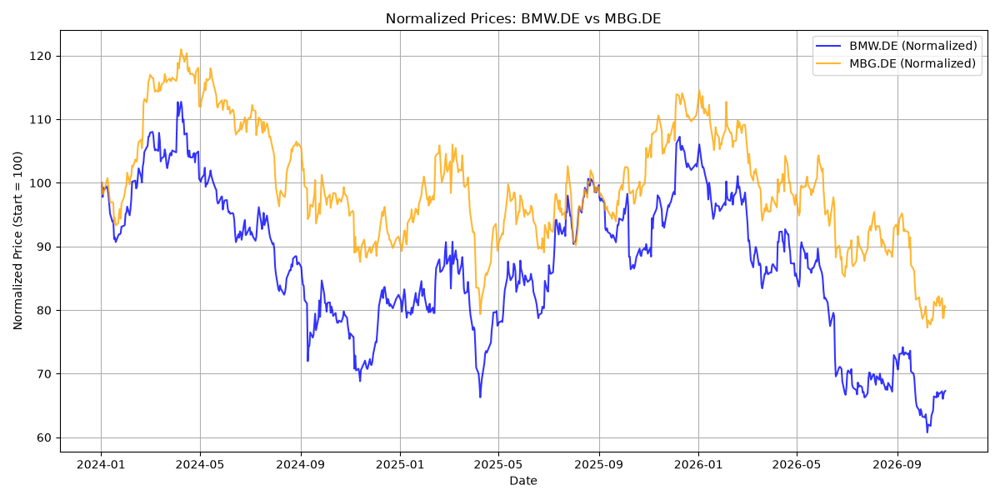
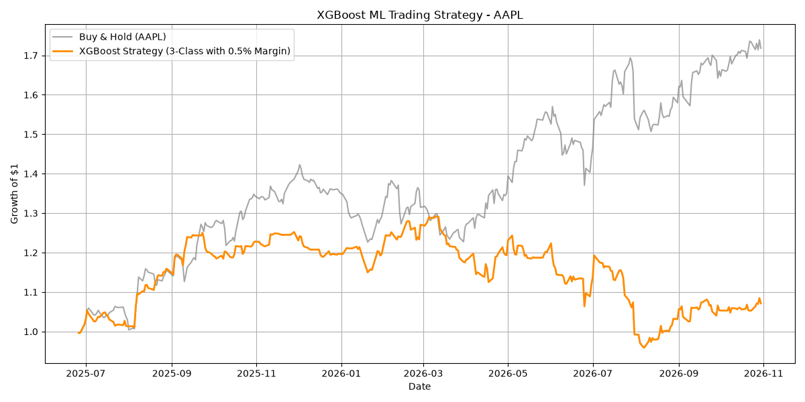

# StockTrading

This project compares basic rule-based and machine-learning stock strategies using historical closing prices. It includes a pairs-trading backtest and three classification-model scripts. The scripts generate performance plots and CSV result files.

## Python Modules

| Module | Purpose |
| --- | --- |
| [`market_data.py`](market_data.py) | Provides the shared `load_close(ticker, start, end)` function. It downloads closing prices with `yfinance` and stores them in `csv/`. Repeated calls with the same parameters use the local CSV cache. As with `yfinance`, the end date is exclusive. |
| [`PairsTrading.py`](PairsTrading.py) | Tests nine hard-coded stock pairs from 2024-01-01 to 2026-11-01. It normalizes prices, calculates the spread and its 30-day Z-score, and compares a mean-reversion strategy with one that adds a stop-loss and maximum holding period. Position changes incur a modeled transaction cost of 0.1%. |
| [`RandomForrest.py`](RandomForrest.py) | Trains a Random Forest classifier on AAPL data. It predicts Short, Cash, or Long for the following day when the return is outside a +/-0.5% threshold. It prints classification metrics and compares the strategy with Buy & Hold over the final chronological 20% test segment. |
| [`XGBoost.py`](XGBoost.py) | Runs a similar AAPL workflow using an XGBoost classifier. Labels are encoded as 0 (Short), 1 (Cash), and 2 (Long) for XGBoost, then mapped back to positions for the backtest. |
| [`ML_Models.py`](ML_Models.py) | Compares Random Forest, XGBoost, and logistic regression using the same chronological 80/20 split. In addition to accuracy, precision, recall, and F1 score, it plots cumulative strategy performance against Buy & Hold. |

The ML scripts use one-, two-, and three-day returns, volatility, RSI, and MACD as features. Positions are shifted by one day so a prediction is not applied to the return from the same day. Each script is a standalone program with hard-coded tickers and date ranges; edit the parameters directly in the corresponding module to change them.

## Installation

Python 3 and an internet connection are required to download market data for the first time. Create a virtual environment in the project directory and install the dependencies:

```bash
python -m venv .venv
source .venv/bin/activate  # Windows: .venv\Scripts\activate
python -m pip install pandas numpy yfinance matplotlib scikit-learn xgboost
```

## Running the Scripts

Run each script from the project directory:

```bash
python PairsTrading.py
python RandomForrest.py
python XGBoost.py
python ML_Models.py
```

`market_data.py` is a helper imported by the ML scripts and does not need to be run separately. `PairsTrading.py` downloads prices directly through `yfinance`. Depending on the local cache and network connection, each run may take some time.

## Outputs

| Script | Plots | Results table |
| --- | --- | --- |
| `PairsTrading.py` | `images/<pair>/prices_and_trades.png`, `zscore_signals_unsecured.png`, `zscore_signals_secured.png` | `csv/backtest_results.csv` |
| `RandomForrest.py` | `images/ml_model/ml_performance.png` | Metrics are printed to the console |
| `XGBoost.py` | `images/ml_model/xgboost_performance.png` | Metrics are printed to the console |
| `ML_Models.py` | `images/ml_models/random_forest_performance.png`, `xgboost_performance.png`, `logistic_regression_performance.png` | `csv/model_comparison_results.csv` |

### Example Plots

Normalized prices for the BMW.DE and MBG.DE pair:



XGBoost strategy compared with Buy & Hold:



These are existing example outputs. Running the scripts again updates the plots.

## Interpretation Notes

These results are historical simulations, not investment advice. They depend on the data source, time period, thresholds, and simplified transaction-cost assumptions. Slippage, taxes, liquidity, and other execution costs are not fully modeled. A strong classification metric also does not necessarily imply a profitable strategy.