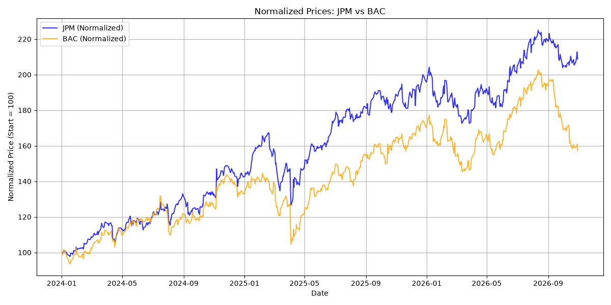
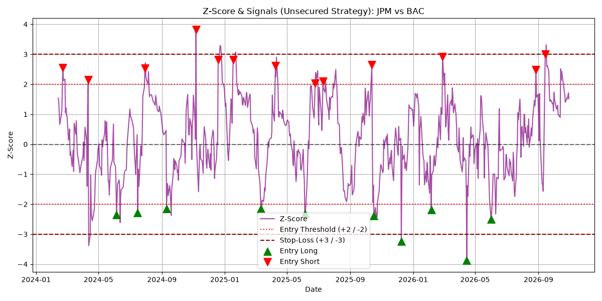
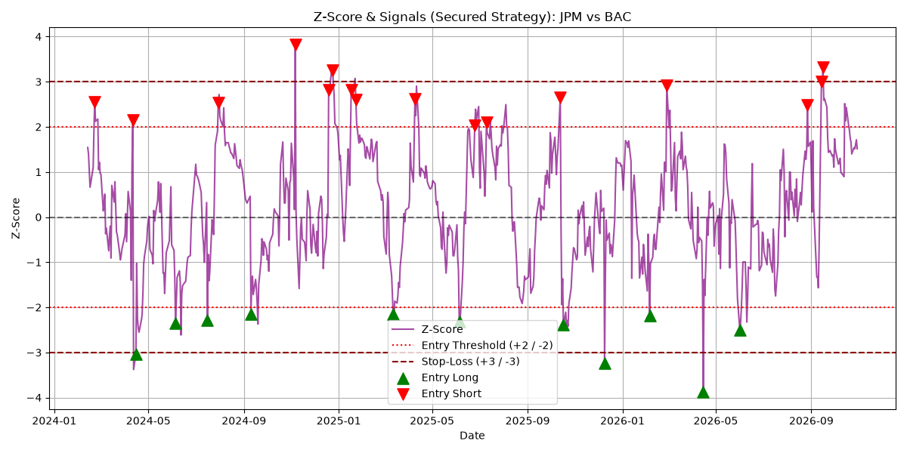
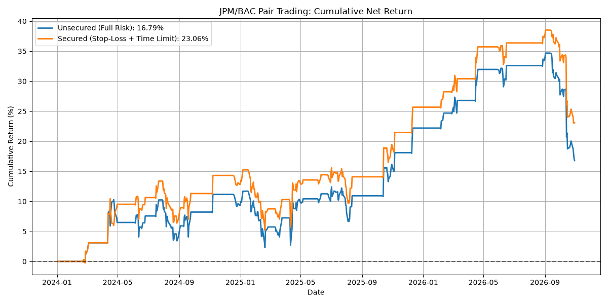
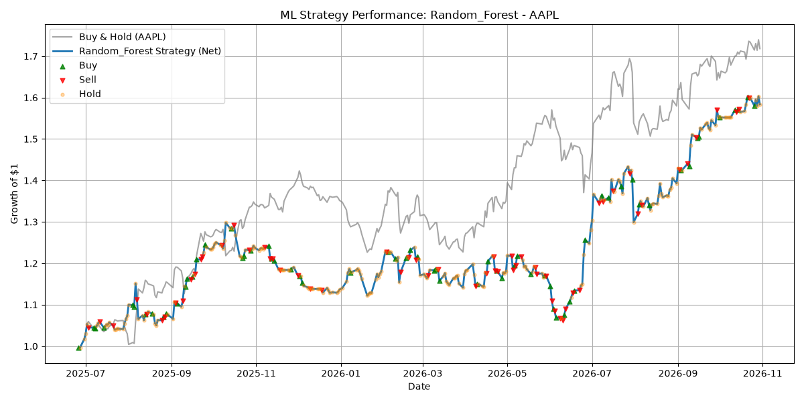
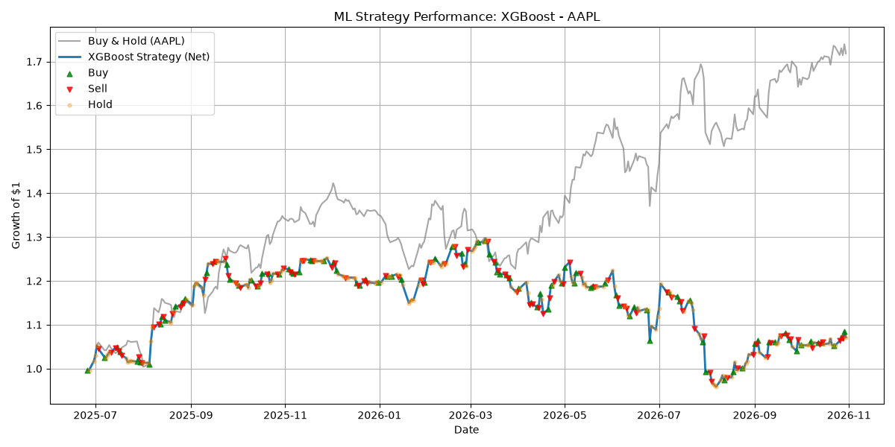
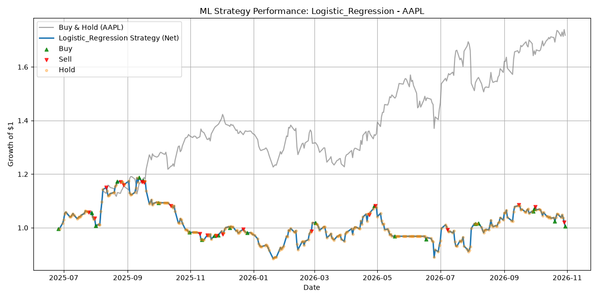

# StockTrading

This project compares a rule-based pairs-trading strategy with machine-learning stock strategies using historical closing prices. The two main workflows are implemented in `PairsTrading.py` and `ML_Models.py`; both generate plots and CSV results.

## Python Modules

| Module | Purpose |
| --- | --- |
| [`market_data.py`](market_data.py) | Provides the shared `load_close(ticker, start, end)` function. It downloads closing prices with `yfinance` and stores them in `csv/`. Repeated calls with the same parameters use the local CSV cache. As with `yfinance`, the end date is exclusive. |
| [`PairsTrading.py`](PairsTrading.py) | Backtests nine hard-coded stock pairs from 2024-01-01 to 2026-11-01. It compares normalized prices, calculates a 30-observation rolling Z-score for their relative spread, and compares a basic mean-reversion strategy with one that also uses a stop-loss and time exit. |
| [`ML_Models.py`](ML_Models.py) | Trains and compares Random Forest, XGBoost, and logistic regression on AAPL data using the same chronological 80/20 split. It reports accuracy, precision, recall, and F1 score, and saves one cumulative-performance plot per model. |

The ML workflow uses one-, two-, and three-day returns, volatility, RSI, and MACD as features. Its target is the next day's return: above +0.5% is Long, below -0.5% is Short, and the range between is Cash. Positions are shifted by one day so a prediction is not applied to the return from the same day. Tickers and date ranges are currently hard-coded in each module.

## Installation

Python 3 and an internet connection are required to download market data for the first time. Create a virtual environment in the project directory and install the dependencies:

```bash
python -m venv .venv
source .venv/bin/activate  # Windows: .venv\Scripts\activate
python -m pip install pandas numpy yfinance matplotlib scikit-learn xgboost
```

## Running the Scripts

Run either workflow from the project directory:

```bash
python PairsTrading.py
python ML_Models.py
```

`market_data.py` is a helper imported by `ML_Models.py` and does not need to be run separately. `PairsTrading.py` downloads prices directly through `yfinance`. Depending on the local cache and network connection, each run may take some time.

## Outputs

| Script | Plots | Results table |
| --- | --- | --- |
| `PairsTrading.py` | `images/<pair>/prices_and_trades.png`, `zscore_signals_unsecured.png`, `zscore_signals_secured.png`; for JPM/BAC also `strategy_performance.png` | `csv/backtest_results.csv` |
| `ML_Models.py` | `images/ml_models/random_forest_performance.png`, `xgboost_performance.png`, `logistic_regression_performance.png` | `csv/model_comparison_results.csv` |

## Pair Trading: Z-Score and JPM/BAC Results

Pair trading looks at the relative movement of two related assets rather than simply buying one stock. In this implementation, each close-price series is normalized to 100 on the first shared trading date. The spread is the first normalized price minus the second. Its Z-score is calculated against a rolling 30-observation mean and standard deviation:

```text
Z-score = (current spread - rolling 30-day mean) / rolling 30-day standard deviation
```

The Z-score expresses how far the current spread is from its recent average in standard-deviation units. A value above +2 means the first stock has recently outperformed the second by an unusually large amount under this measure; the strategy bets on a reversal by shorting the first stock and going long the second. Below -2 it takes the opposite position. It exits when the Z-score returns to the range from -0.5 to +0.5.

The secured variant adds two further exit rules: close the position if the absolute Z-score exceeds 3, or if the trade has lasted 30 observations. The unsecured variant does not enforce either limit; its plot still shows the +/-3 reference lines for visual comparison. Green upward markers indicate long-spread entries and red downward markers indicate short-spread entries. The plots mark entries, not exits.

### JPM/BAC Example

The normalized-price plot starts both series at 100 so their relative performance can be compared despite different share prices. Over the plotted period, JPM rises more than BAC, but the pair strategy does not simply buy JPM: it trades temporary deviations in their relative spread and can hold either direction.



The unsecured Z-score plot shows the rolling spread deviation, +/-2 entry thresholds, and +/-3 reference levels. Several large deviations reach beyond the reference stop level, but that level is not an enforced exit in the unsecured strategy.



In the secured plot, the same +/-3 levels are active stop-loss thresholds, alongside the 30-observation time limit. The strategy can therefore exit a trade before mean reversion; the plot still marks entries only, so the exact exit dates are not shown.



This performance plot shows the cumulative net return of both JPM/BAC strategies over time. “Full Risk” is the unsecured strategy: it exits only when the Z-score returns to the mean range. The second curve uses both the stop-loss and 30-observation time limit. The final percentages in the legend include the modeled transaction costs and should match the corresponding totals in the CSV for the same run. Both curves also fall substantially from their 2026 peaks, so the positive final returns hide meaningful interim drawdowns.



The currently stored [`backtest_results.csv`](csv/backtest_results.csv) reports these net returns for JPM/BAC, after the script's modeled transaction costs:

| Variant | Net return |
| --- | ---: |
| Unsecured mean-reversion strategy | 16.79% |
| Secured strategy with stop-loss and time exit | 23.06% |

These are total backtest returns over the selected period, not annualized returns and not a comparison against Buy & Hold. As an illustration, if these returns were applied to a $10,000 starting balance, the modeled gains would be $1,679 for Full Risk and $2,306 for the secured strategy, before any costs not included in the script. The script does not define a starting balance or explicit portfolio sizing, so dollar profit scales with the assumed capital.

The calculation applies the position to the difference between the two stocks' daily percentage returns, with 0.1% modeled cost per unit of position change. It is a simplified simulation, not a fully weighted portfolio or execution model.

## ML Model Plots

Each chart covers the final chronological 20% test segment for AAPL. The horizontal axis is date and the vertical axis is the cumulative growth of an initial $1. The gray line is Buy & Hold; the blue line is the model strategy after the script's 0.1% transaction cost per unit of position change. Green, red, and orange markers indicate the script's Buy, Sell, and Hold actions. Comparing the lines shows both the strategy's path and its ending value relative to holding AAPL throughout the test period.

### Random Forest



In this saved plot, the Random Forest strategy rises to roughly $1.59 per initial dollar. It finishes below Buy & Hold, which ends around $1.74, but it has the strongest ending value of the three model strategies shown here. Its path also includes long flat or declining stretches where Buy & Hold continues to gain.

### XGBoost



XGBoost initially follows some of the market's gains, then loses ground through the later part of the test interval. It finishes near $1.08 per initial dollar in this plot, well below the Buy & Hold curve. The markers make frequent position changes visible; transaction costs are included in the blue strategy line.

### Logistic Regression



The logistic-regression strategy fluctuates around its starting value and finishes only slightly above $1 in this saved plot. It substantially trails Buy & Hold over the same dates. This illustrates why classification metrics alone do not describe trading performance: prediction quality, position changes, transaction costs, and the market's direction all affect the cumulative result.

The images are saved outputs and may reflect a previous run. For the latest numeric model metrics and total strategy returns, see [`model_comparison_results.csv`](csv/model_comparison_results.csv); rerunning `ML_Models.py` updates both the plots and that table.

## Interpretation Notes

These results are historical simulations, not investment advice. They depend on the data source, time period, thresholds, and simplified transaction-cost assumptions. Slippage, taxes, liquidity, and other execution costs are not fully modeled. A strong classification metric also does not necessarily imply a profitable strategy.