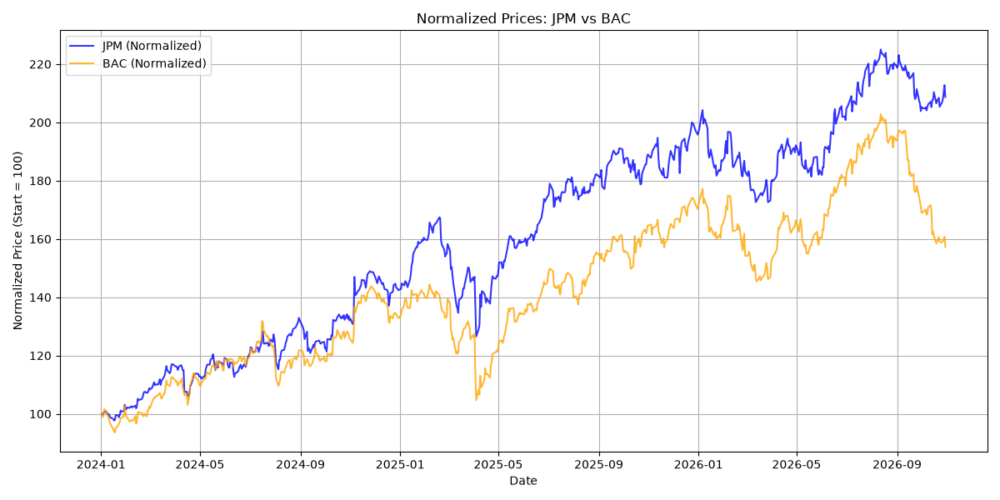
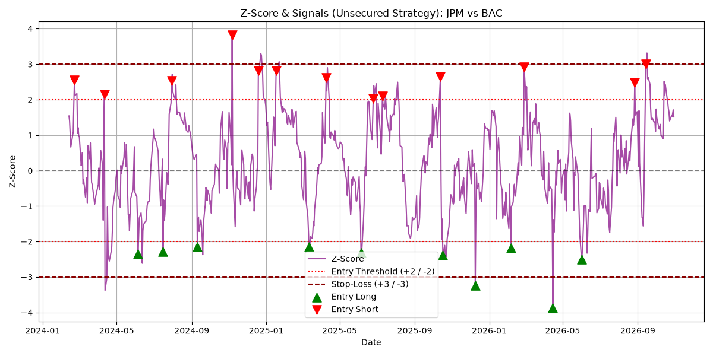
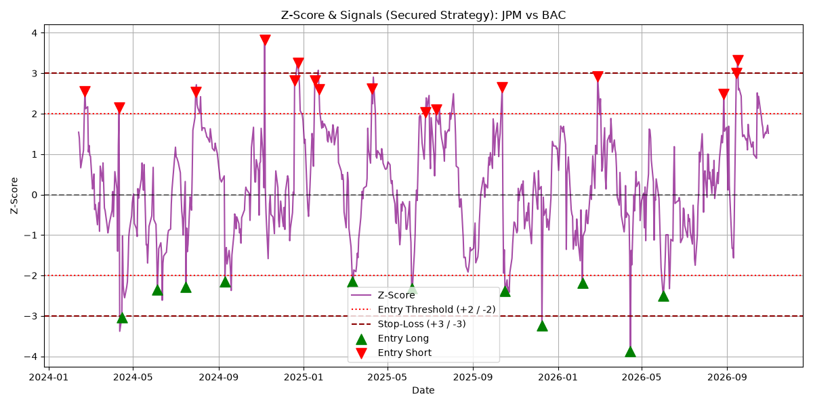
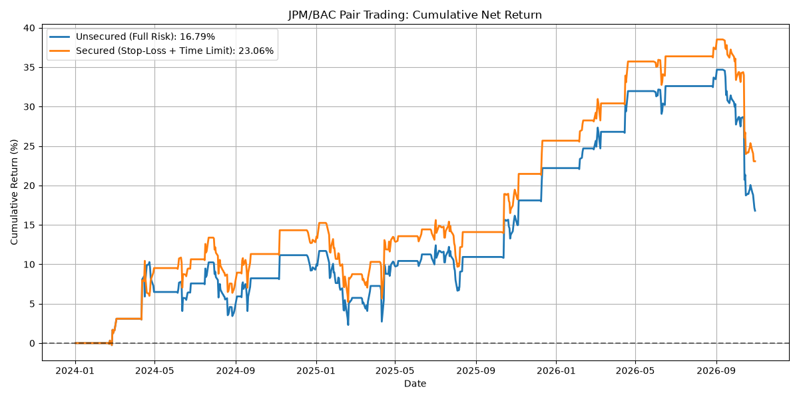

# StockTrading

This project compares a rule-based pairs-trading strategy with machine-learning stock strategies using historical closing prices. The two main workflows are implemented in `PairsTrading.py` and `ML_Models.py`; both generate plots and CSV results.

## Python Modules

| Module | Purpose |
| --- | --- |
| [`market_data.py`](market_data.py) | Provides the shared `load_close(ticker, start, end)` function. It downloads split- and dividend-adjusted closing prices with `yfinance` and stores them in versioned CSV caches. Repeated calls use the cache. As with `yfinance`, the end date is exclusive. |
| [`PairsTrading.py`](PairsTrading.py) | Backtests nine hard-coded stock pairs from 2024-01-01 to 2026-11-01. It compares normalized prices, calculates a 30-observation rolling Z-score for their relative spread, and compares a basic mean-reversion strategy with one that also uses a stop-loss and time exit. |
| [`ML_Models.py`](ML_Models.py) | Trains five regressors on a pooled 10-stock universe, selects thresholds and a model with expanding walk-forward validation, and evaluates both market-neutral signals and a cash-limited multi-stock portfolio. |

The ML workflow uses one-, two-, five-, ten-, and twenty-day returns, realized volatility, RSI, MACD, SPY/QQQ returns, peer returns, and relative-spread features for JPM/BAC and XOM/CVX. Regressors estimate each stock's five-session return relative to the equal-weighted stock universe. Features are observed at a close, and predictions are applied at the next close; the target covers the following five sessions. Positions are ranked across stocks and rebalanced every five sessions. Thresholds are selected only on earlier walk-forward folds. Tickers, date range, costs, thresholds, and budget-account settings are configured near the top of the script.

## Installation

Python 3 and an internet connection are required to download market data for the first time. Create a virtual environment in the project directory and install the dependencies:

```bash
python -m venv .venv
source .venv/bin/activate  # Windows: .venv\Scripts\activate
python -m pip install pandas numpy yfinance matplotlib scikit-learn xgboost
```

## Running the Scripts

Run either workflow from the project directory:

```bash
python PairsTrading.py
python ML_Models.py
```

`market_data.py` is a helper imported by `ML_Models.py` and does not need to be run separately. `PairsTrading.py` downloads prices directly through `yfinance`. Depending on the local cache and network connection, each run may take some time.

## Outputs

| Script | Plots | Results table |
| --- | --- | --- |
| `PairsTrading.py` | `images/<pair>/prices_and_trades.png`, `zscore_signals_unsecured.png`, `zscore_signals_secured.png`; for JPM/BAC also `strategy_performance.png` | `csv/backtest_results.csv` |
| `ML_Models.py` | Portfolio plots in `images/ml_models/`; per-stock plots in `images/ml_models/<TICKER>/<model>_performance.png`; selected capital-limited account in `images/ml_models/selected_budget_portfolio.png` | `csv/model_comparison_results.csv`, plus the budget-account files below |

The selected budget portfolio has a default starting balance of $10,000, is long-only, holds fractional shares, and targets no more than 20% of account value per stock at each rebalance. It invests only when at least three stocks pass the selected threshold; otherwise it can remain in cash. The model and threshold are selected using walk-forward Sharpe ratios for this budgeted simulation, not by the final holdout. Orders are modeled at the next close, with 0.1% commission and 0.05% slippage per traded dollar. The output files are `csv/budget_portfolio_summary.csv`, `csv/budget_portfolio_equity_curve.csv` (daily account value, cash and benchmarks), `csv/budget_portfolio_trades.csv`, and `csv/budget_portfolio_positions.csv`.

## Pair Trading: Z-Score and JPM/BAC Results

Pair trading looks at the relative movement of two related assets rather than simply buying one stock. In this implementation, each close-price series is normalized to 100 on the first shared trading date. The spread is the first normalized price minus the second. Its Z-score is calculated against a rolling 30-observation mean and standard deviation:

```text
Z-score = (current spread - rolling 30-day mean) / rolling 30-day standard deviation
```

The Z-score expresses how far the current spread is from its recent average in standard-deviation units. A value above +2 means the first stock has recently outperformed the second by an unusually large amount under this measure; the strategy bets on a reversal by shorting the first stock and going long the second. Below -2 it takes the opposite position. It exits when the Z-score returns to the range from -0.5 to +0.5.

The secured variant adds two further exit rules: close the position if the absolute Z-score exceeds 3, or if the trade has lasted 30 observations. The unsecured variant does not enforce either limit; its plot still shows the +/-3 reference lines for visual comparison. Green upward markers indicate long-spread entries and red downward markers indicate short-spread entries. The plots mark entries, not exits.

### JPM/BAC Example

The normalized-price plot starts both series at 100 so their relative performance can be compared despite different share prices. Over the plotted period, JPM rises more than BAC, but the pair strategy does not simply buy JPM: it trades temporary deviations in their relative spread and can hold either direction.



The unsecured Z-score plot shows the rolling spread deviation, +/-2 entry thresholds, and +/-3 reference levels. Several large deviations reach beyond the reference stop level, but that level is not an enforced exit in the unsecured strategy.



In the secured plot, the same +/-3 levels are active stop-loss thresholds, alongside the 30-observation time limit. The strategy can therefore exit a trade before mean reversion; the plot still marks entries only, so the exact exit dates are not shown.



This performance plot shows the cumulative net return of both JPM/BAC strategies over time. “Full Risk” is the unsecured strategy: it exits only when the Z-score returns to the mean range. The second curve uses both the stop-loss and 30-observation time limit. The final percentages in the legend include the modeled transaction costs and should match the corresponding totals in the CSV for the same run. Both curves also fall substantially from their 2026 peaks, so the positive final returns hide meaningful interim drawdowns.



The currently stored [`backtest_results.csv`](csv/backtest_results.csv) reports these net returns for JPM/BAC, after the script's modeled transaction costs:

| Variant | Net return |
| --- | ---: |
| Unsecured mean-reversion strategy | 16.79% |
| Secured strategy with stop-loss and time exit | 23.06% |

These are total backtest returns over the selected period, not annualized returns and not a comparison against Buy & Hold. As an illustration, if these returns were applied to a $10,000 starting balance, the modeled gains would be $1,679 for Full Risk and $2,306 for the secured strategy, before any costs not included in the script. The script does not define a starting balance or explicit portfolio sizing, so dollar profit scales with the assumed capital.

The calculation applies the position to the difference between the two stocks' daily percentage returns, with 0.1% modeled cost per unit of position change. It is a simplified simulation, not a fully weighted portfolio or execution model.

## ML Model Evaluation

The script compares Random Forest, Extra Trees, Histogram Gradient Boosting, XGBoost, and scaled Ridge Regression. All stocks are pooled into one training set. Market-neutral entry thresholds are selected on three expanding, chronological validation folds; the models are then refit on the development period and evaluated on the final 20% of weekly signal dates. Separately, model and threshold selection for the dollar-denominated portfolio uses the same chronological validation approach, optimizing the budget simulation's Sharpe ratio.

Portfolio signals are market-neutral: the long and short sides each receive half of gross exposure, with inverse-volatility weighting. The backtest charges 0.1% commission and 0.05% slippage per unit of turnover and 3% annualized borrow cost on short exposure. It reports comparisons with SPY, equal-weight buy-and-hold, cash, 20-day momentum, 20-day mean reversion, and a seeded random baseline. The CSV includes per-model portfolio rows and per-model/per-stock rows with forecast error, returns, Sharpe ratio, drawdown, and turnover. Per-stock charts include Buy/Sell/Hold markers.

The JPM/BAC and XOM/CVX spread features provide pair context, but this is not a cointegration-tested pair-spread strategy. Inverse-volatility weighting is not a volatility-harvesting forecast. The final historical period was examined in an earlier iteration, so it is not a pristine holdout; model/threshold selection itself uses only the earlier walk-forward folds. Results remain simulations and omit taxes, market impact, and other execution details. The budget account's final holdout results are historical, not a guarantee of future performance or investment advice.

## Interpretation Notes

These results are historical simulations, not investment advice. They depend on the data source, time period, thresholds, and simplified transaction-cost assumptions. Slippage, taxes, liquidity, and other execution costs are not fully modeled. A strong classification metric also does not necessarily imply a profitable strategy.